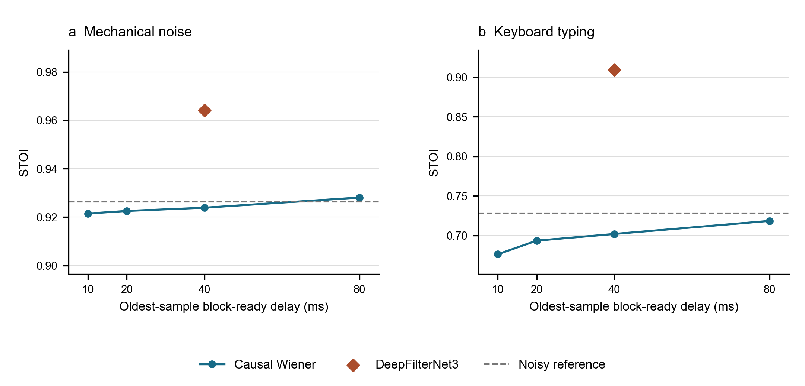
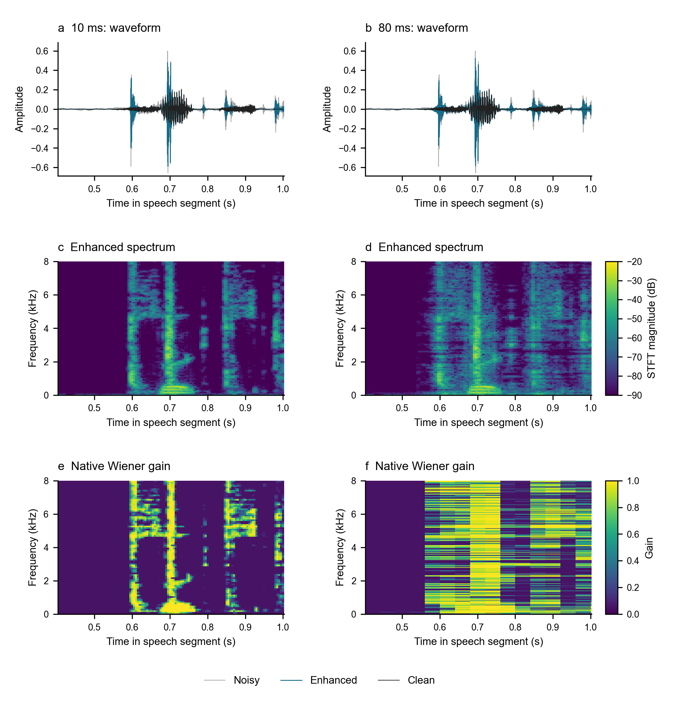

# Latency-Quality Trade-offs in Causal Speech Enhancement

**Student:** Yixiang Ma | **SID:** 550762913 | **Course:** ELEC5305

**Progress updated:** 28 October 2026

## Research Question

How much enhancement quality can a causal system retain under a strict latency budget? Following teacher feedback, Wiener filtering is a classical baseline for studying this trade-off, not the research contribution itself. The current contribution is a reproducible comparison with explicit framing, calibration, delay, and timing assumptions.

## Second Progress Stage

The MATLAB baseline processes sequential blocks with persistent state. The current experiment uses 4.5 seconds of one recorded 48 kHz VoiceBank utterance, mixed separately with real washing-machine and keyboard noise at 0 dB input SNR. Both methods receive identical mixtures, including a 300 ms noise-only prefix and a 100 ms recorded-noise tail. Speech quality is scored only over the 4.5-second utterance.

The new reference is the official pretrained **DeepFilterNet3** model using the stateful Rust/Tract executable. No neural network is trained or fine-tuned. Its actual frame loop and lookahead were inspected, and its known transport shift was independently probed. Changing future input left already-emitted output unchanged.

### Results at Comparable Block-Ready Delay

| Noise | Method | Ready delay (ms) | Output SNR (dB) | SI-SDR (dB) | STOI |
| --- | --- | --- | --- | --- | --- |
| Washing machine | Noisy | N/A | 0.00 | -0.02 | 0.9263 |
| Washing machine | Wiener, 40 ms window | 40 | 2.27 | 2.22 | 0.9239 |
| Washing machine | DeepFilterNet3, 20 ms window | 40 | 18.90 | 18.97 | 0.9641 |
| Keyboard | Noisy | N/A | 0.00 | -0.07 | 0.7280 |
| Keyboard | Wiener, 40 ms window | 40 | 2.02 | 1.68 | 0.7020 |
| Keyboard | DeepFilterNet3, 20 ms window | 40 | 12.93 | 12.78 | 0.9092 |

The four Wiener points correspond to 10/20/40/80 ms windows. DeepFilterNet3 uses a 20 ms window, a 10 ms hop, and two frames of lookahead. Its transport shift is 30 ms, while the oldest-sample block-ready delay under the common convention is 40 ms. The plotted delay excludes compute and device buffering; the 300 ms calibration is a separate startup requirement. This is a causal recorded-file simulation, not a microphone-to-speaker latency measurement.

### What the Results Show

In both examples, Wiener improves waveform SNR. However, all four Wiener settings reduce keyboard STOI below the noisy input's 0.7280. DeepFilterNet3 achieves 0.9092 in this keyboard example. These observations show why SNR alone is insufficient; they do not establish performance on unseen speakers or noise recordings.

The event is selected from the true noise energy without using enhancement scores. The 10 ms and 80 ms branches use the same input and display-spectrogram settings; gain maps retain each method's native frame grid. This is an illustrative failure-case inspection, not an additional independent test sample.

### Reproducibility and Remaining Work

Reconstruction and future-input checks passed for the Wiener implementation. The reference's measured transport shift matches its configuration, its repeated outputs are identical, and no PCM16 clipping was detected. Seven-repeat RTF medians are below one for these runs, but this is not a per-block deadline guarantee. MATLAB and Rust timing and precision differ, so RTF must not be interpreted as an implementation-independent complexity ranking.

[Full results, timing definitions, checks, and provenance](results/latency_milestone2/) | [Exact metrics](results/latency_milestone2/metrics.csv) | [Runnable code and instructions](https://github.com/Simon1ma/elec5305-project-550762913/tree/main/code/latency) | [GitHub repository](https://github.com/Simon1ma/elec5305-project-550762913)

The next stage requires more speakers, separate development/evaluation noise sources, multiple SNRs, and deadline-level timing. The current speech clip is development data, and overlap with the pretrained model's training data has not been independently ruled out. Raw third-party recordings and model binaries are not republished here; the scripts retrieve documented sources.

## Earlier Work

- [First causal milestone: washing-machine example and streaming checks](results/latency_milestone1/). This uses a longer utterance and a different timing scope; do not interpret cross-milestone metric differences as algorithmic improvement.
- [Historical offline synthetic experiment, 9 October 2026](results/preliminary/). FIR and whole-file Wiener results are not causal low-latency evidence.
- [Feedback action plan](https://github.com/Simon1ma/elec5305-project-550762913/blob/main/docs/teacher_feedback_action_plan.md).

## Technical Sources

- [VoiceBank+DEMAND clean speech](https://doi.org/10.7488/ds/2117), [DEMAND environmental noise](https://zenodo.org/records/1227121), and [ESC-50](https://github.com/karolpiczak/ESC-50).
- [Official DeepFilterNet code, models, and releases](https://github.com/Rikorose/DeepFilterNet). Exact versions and source links are recorded with the experiment.
- P. Scalart and J. V. Filho, "Speech enhancement based on a priori signal to noise estimation," 1996. [DOI](https://doi.org/10.1109/ICASSP.1996.543199).
- C. H. Taal et al., "An algorithm for intelligibility prediction of time-frequency weighted noisy speech," 2011. [DOI](https://doi.org/10.1109/TASL.2011.2114881).
- J. Le Roux et al., "SDR - half-baked or well done?" [Author manuscript](https://arxiv.org/abs/1811.02508).
