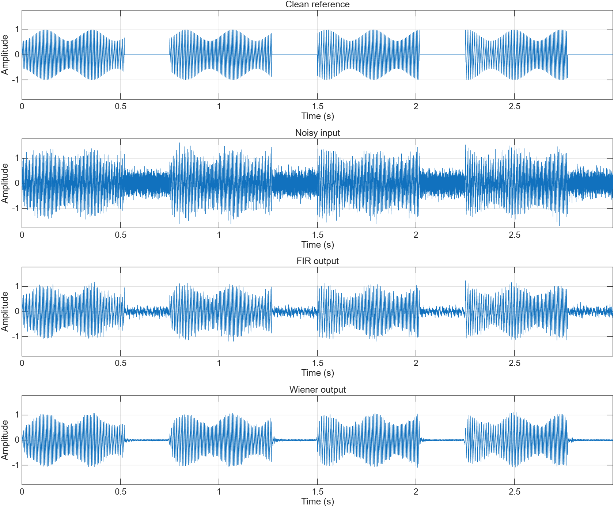
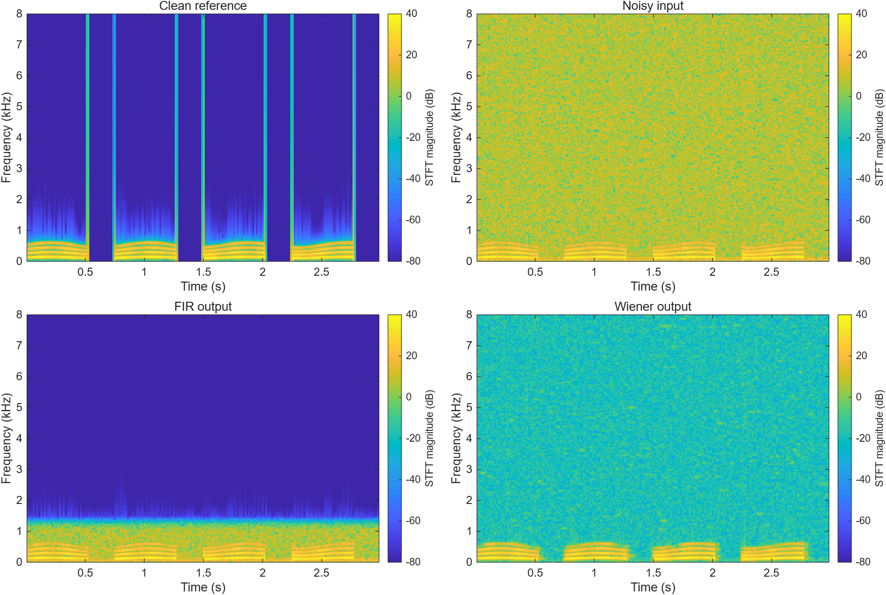
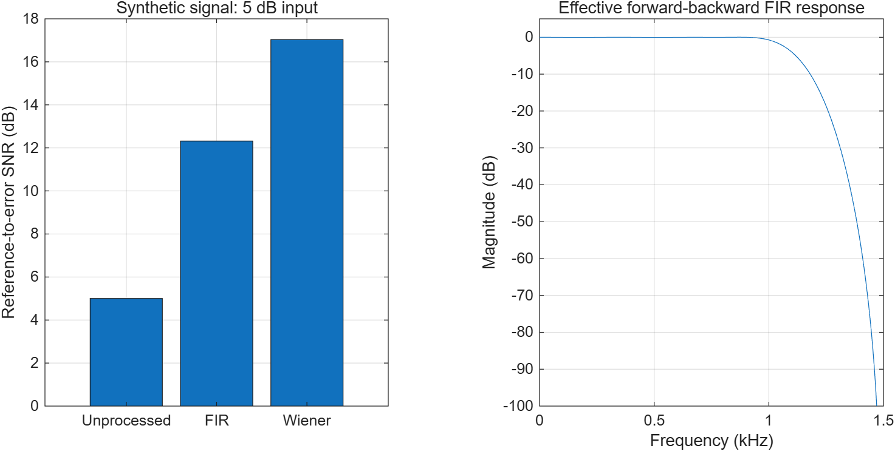

# Latency-Quality Trade-offs in Causal Speech Enhancement

**Student:** Yixiang Ma | **SID:** 550762913 | **Course:** ELEC5305

**Progress updated:** 28 October 2026

## Revised Research Question

How much enhancement quality can a causal system retain under a strict latency budget? Following teacher feedback, Wiener filtering is now a classical baseline for studying this trade-off, rather than the research contribution itself.

## New Progress: Causal Recorded-Speech Experiment

The revised MATLAB processor consumes sequential input blocks with persistent state and no access to future samples. The first experiment uses one native 48 kHz VoiceBank speech utterance and a DEMAND washing-machine noise recording at 0 dB input SNR, with 300 ms initial noise calibration. Four 10/20/40/80 ms analysis windows passed reconstruction, future-invariance, chunking, and impulse-shift checks.

| Window (ms) | Oldest-sample ready delay (ms) | Output SNR (dB) | SI-SDR (dB) | STOI | Median RTF |
| --- | --- | --- | --- | --- | --- |
| 10 | 10 | 3.12 | 2.65 | 0.9273 | 0.0291 |
| 20 | 20 | 2.83 | 2.76 | 0.9295 | 0.0192 |
| 40 | 40 | 1.92 | 1.87 | 0.9307 | 0.0146 |
| 80 | 80 | 1.28 | 1.23 | 0.9330 | 0.0118 |

The unprocessed STOI is 0.9310. Higher SNR does not imply higher STOI in this example. These small quality differences are observations on one development utterance; they do not establish the best general window size.


The plotted delay is the oldest sample's age when its output block is ready. It includes the capture packet and excludes CPU/device/network delays. The waveform transport shift is separately 5/10/20/40 ms; 300 ms calibration is a separate startup requirement. RTF is seven-repeat median compute time divided by input duration, with I/O and plotting excluded. This causal file simulation is not an end-to-end microphone latency measurement or a hard real-time guarantee.

[Detailed revised results and limitations](results/latency_milestone1/) | [Revised code and reproduction](https://github.com/Simon1ma/elec5305-project-550762913/tree/main/code/latency)

Actual keyboard/transient-noise evaluation, larger speaker-disjoint evaluation, and the pretrained DeepFilterNet reference are not yet completed.

## Historical Offline Progress (9 October 2026)

The following FIR comparison is retained as previous offline work. It is not a causal low-latency experiment and is not the current research contribution.

[GitHub repository](https://github.com/Simon1ma/elec5305-project-550762913) | [MATLAB code](https://github.com/Simon1ma/elec5305-project-550762913/tree/main/code) | [Detailed results](results/preliminary/)

## Project Goal

The project investigates whether STFT-domain Wiener filtering can improve speech enhancement compared with a fixed FIR low-pass filter under different noise types and input SNR conditions. The implementation is now in MATLAB, extending the earlier synthetic-signal audio processing exercise. The initial Python proposal remains in the repository as historical planning material.

## Achieved So Far

The preliminary pipeline generates a 3-second synthetic speech-like signal at 16 kHz and adds white Gaussian noise plus 60/120 Hz hum at exactly 5 dB input SNR. Both enhancement methods process the same mixture. A 0.3-second noise-only prefix supplies the Wiener noise estimate, and this prefix is excluded from evaluation.

The FIR baseline uses order 96, a 1200 Hz cutoff, a Hamming window, and forward-backward filtering. The Wiener branch uses a 512-sample Hann window, 256-sample hop, 1024-point FFT, and decision-directed gains. It retains the noisy phase and reconstructs the signal with inverse STFT. The clean reference is used for mixture generation and scoring, not as input to the Wiener algorithm.

## Measured Preliminary Results

| Method | Input SNR (dB) | Output SNR (dB) | Improvement (dB) |
| --- | --- | --- | --- |
| Unprocessed | 5.00 | 5.00 | 0.00 |
| FIR | 5.00 | 12.32 | 7.32 |
| Wiener | 5.00 | 17.04 | 12.04 |

Output SNR compares the clean reference with the full output error, including residual noise and speech distortion. It is calculated before any listening-file attenuation. Wiener has a 4.72 dB higher output SNR in this single example; this is not a claim of general superiority.

[Download exact metrics](results/preliminary/metrics.csv) | [Execution details](results/preliminary/run_summary.txt)

### Time-Domain Comparison



The four plots use the same amplitude limits. Both methods reduce the added noise. In this example, Wiener reduces noise particularly in the intervals where the synthetic signal is inactive.

### STFT Spectrogram Comparison



All spectrograms use identical colour limits. FIR suppresses frequencies above its cutoff. Wiener attenuates noise while retaining the low-frequency harmonic pattern. Broadband transients also exist in the clean signal because its syllable gate changes abruptly.

### Numerical Comparison and FIR Response



The FIR response shown is the effective forward-backward magnitude response. Both methods are currently offline algorithms.

## Audio Demonstration

All clips receive the same attenuation to avoid clipping. They are synthetic speech-like sounds, not spoken sentences.

**Clean reference**

<audio controls preload="none" src="results/preliminary/audio/clean.wav"></audio>

[Download clean reference](results/preliminary/audio/clean.wav)

**Noisy input**

<audio controls preload="none" src="results/preliminary/audio/noisy.wav"></audio>

[Download noisy input](results/preliminary/audio/noisy.wav)

**FIR output**

<audio controls preload="none" src="results/preliminary/audio/fir.wav"></audio>

[Download FIR output](results/preliminary/audio/fir.wav)

**Wiener output**

<audio controls preload="none" src="results/preliminary/audio/wiener.wav"></audio>

[Download Wiener output](results/preliminary/audio/wiener.wav)

## Reproducibility

The experiment ran in MATLAB R2026a Update 5 with Signal Processing Toolbox and random seed 7. Unit-gain STFT/ISTFT reconstruction relative error was about 2e-16. Checks passed for reconstruction, non-hop-aligned lengths, gain bounds, noise-only frame selection, controlled SNR mixing, and identical metrics on repeated runs.

From the repository root, run:

```matlab
addpath(fullfile(pwd, 'code'));
results = main_preliminary();
```

[Run instructions and parameter details](https://github.com/Simon1ma/elec5305-project-550762913/blob/main/code/README.md) | [Unscaled signals and configuration](results/preliminary/experiment.mat)

## Limitations and Next Work

Only one synthetic signal and one stationary noise mixture have been evaluated. SNR improvement does not establish improved intelligibility. The initial noise estimate can become inaccurate when noise changes, and spectral attenuation can also distort the desired signal. The current Wiener parameters are initial settings, not final optimised values.

Next steps are recorded speech from [LibriSpeech](https://www.openslr.org/12/), environmental noise from [DEMAND](https://zenodo.org/records/1227121), speaker-separated development/evaluation subsets, and fixed-parameter comparisons at 0, 5, and 10 dB. Segmental SNR and failure-case analysis will extend the current evaluation.

Feedback on the baseline, noise-estimation assumptions, and evaluation design will guide the next stage.

## Technical References

- P. Scalart and J. V. Filho, "Speech enhancement based on a priori signal to noise estimation," ICASSP, 1996. [DOI](https://doi.org/10.1109/ICASSP.1996.543199).
- J. S. Lim and A. V. Oppenheim, "Enhancement and bandwidth compression of noisy speech," Proceedings of the IEEE, 1979. [DOI](https://doi.org/10.1109/PROC.1979.11540).
- [MathWorks STFT documentation](https://www.mathworks.com/help/signal/ref/stft.html) and [ISTFT documentation](https://www.mathworks.com/help/signal/ref/istft.html).

