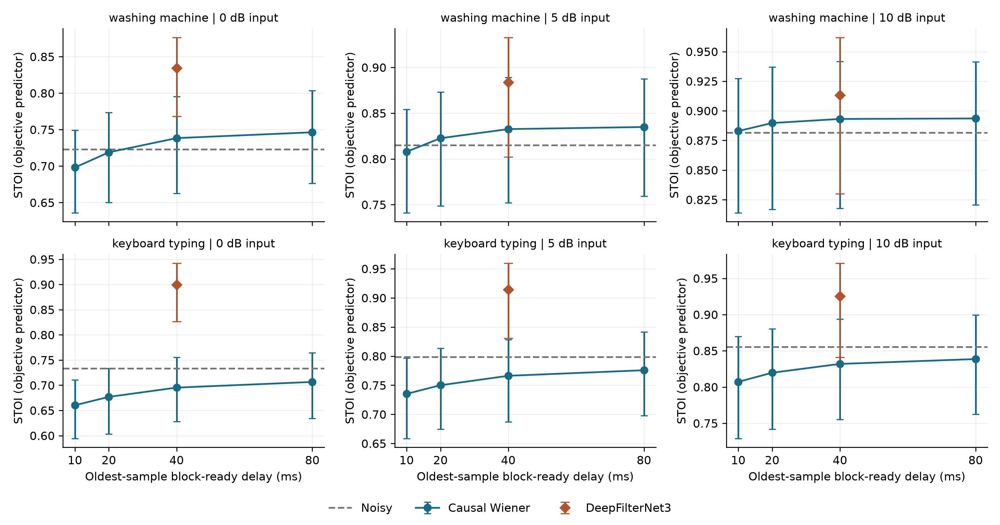
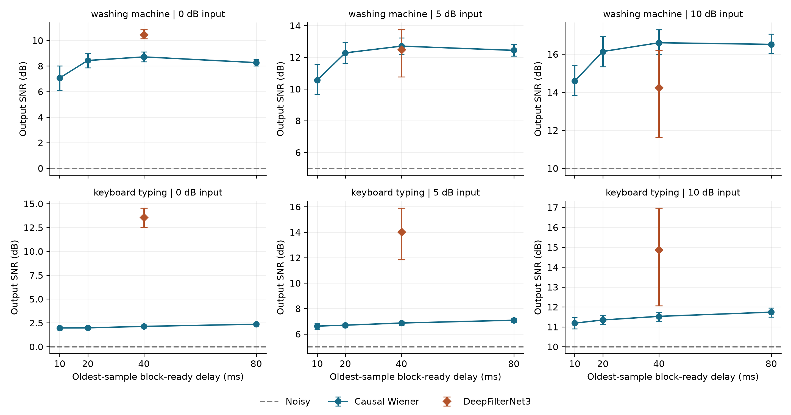
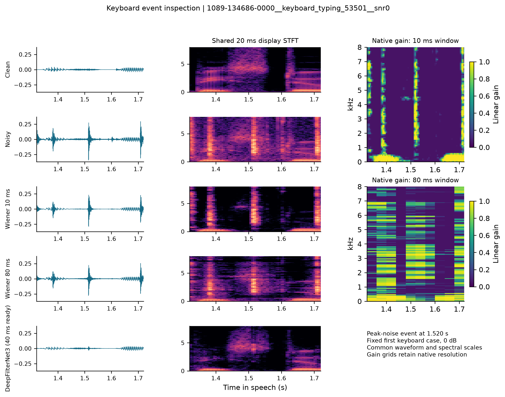
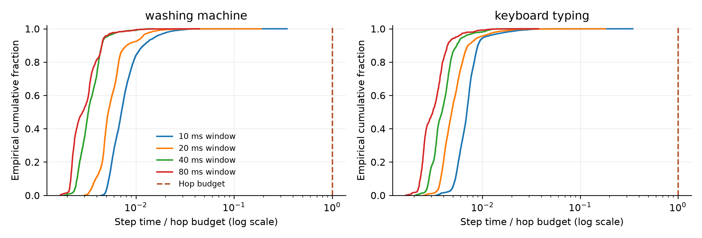
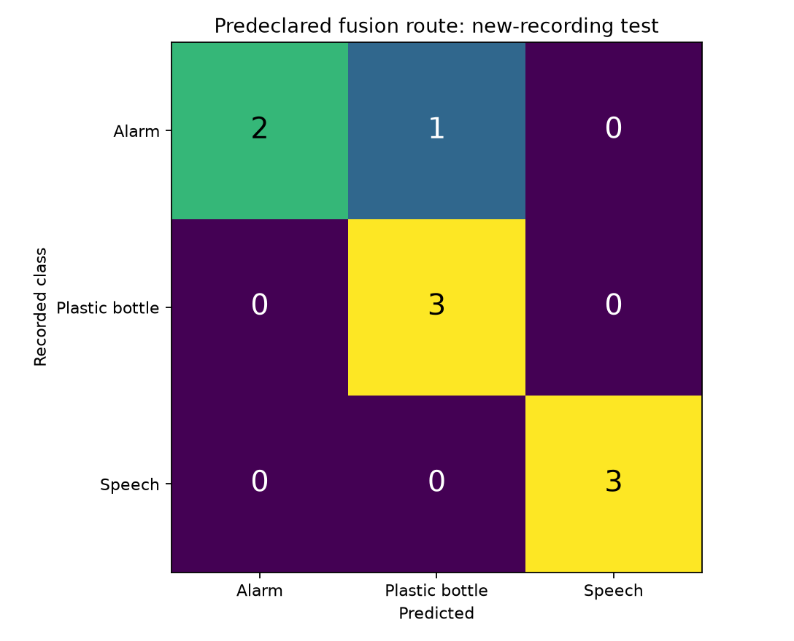

Sound-Scene Analysis and Latency-Quality Trade-offs in Causal Speech Enhancement

ELEC5305 Final Project | Yixiang Ma | SID 550762913 | 14 November 2026

### Abstract

How do output delay and noise-estimation assumptions affect causal speech-enhancement quality across recorded sound conditions? We test four STFT Wiener windows (10/20/40/80 ms) with a shared 100 ms decision-directed smoothing time constant and compare them with the official pretrained DeepFilterNet3 reference. The primary LibriSpeech test-clean evaluation contains 144 paired mixtures from twelve utterances, six speakers, four noise recordings and three input SNRs. A native-48-kHz VCTK-derived cohort provides a secondary engineering comparison. On LibriSpeech at 0 dB keyboard SNR, Wiener40 raises waveform SNR to 2.13 dB but lowers STOI from 0.7336 to 0.6953. At the same 40 ms oldest-sample block-ready delay, DeepFilterNet3 reaches 13.55 dB SNR and 0.8998 STOI. Longer Wiener windows improve mean STOI in this condition, although waveform SNR peaks earlier. All 25,718 profiled external Wiener calls fit within their hop budgets on the tested CPU. A connected personal-recording study identifies 8/9 new isolated sound recordings using frozen multi-scale fusion. Twenty-seven reading/bottle mixtures expose a quiet-prefix calibration failure. An exploratory online power tracker raises SNR at 0 dB by 2.69 dB but reduces STOI in all 27 mixtures, illustrating speech-contamination costs.

## 1. Introduction and research question

A causal speech enhancer must choose what to suppress using only the audio that has arrived. A longer analysis window may reveal spectral structure more clearly, but it also makes the processor wait longer and groups events across a wider interval. Average processing time can hide a slow individual block. We therefore measure quality, output readiness and computation separately.

Research question: How do output delay and noise-estimation assumptions affect causal speech-enhancement quality across recorded sound conditions? We examine single-channel speech mixed with recorded noise, using objective metrics and the official pretrained reference.

To examine the sound-condition component of this question, the personal-recording study characterises acoustic structure alongside enhancement failures. Nine development and nine new recordings cover plastic-bottle pressing, alarms and Chinese reading. A frozen dual-scale classifier identifies 8/9 new sources. Twenty-seven reading/bottle mixtures expose a non-representative calibration prefix. A subsequent online-estimation comparison is explicitly exploratory.

### 1.1 Contribution and project continuity

The semester project began with an offline demonstration using synthetic signals, FIR filtering and Wiener filtering. We then built a stateful causal processor, added recorded keyboard noise to the tests and introduced a pretrained comparator. The final study retains these processors and extends the evaluation to more speakers, noise recordings and input SNRs. We vary the Wiener window, put both output schedules on the same delay basis, compare paired quality scores and examine one keyboard event.

The earlier single-utterance examples form the development stage. Code, protocol, source identifiers, checks, full result tables and an audition app accompany this report.


---

## Contents

Contents are generated with linked section headings and page numbers in the PDF.


---

## 2. Literature review and research rationale

### 2.1 Statistical spectral enhancement

Ephraim and Malah [1] distinguish Wiener spectral estimation from MMSE short-time spectral-amplitude estimation. Their decision-directed estimate of a priori SNR combines the current observation with preceding enhanced power. We use that idea to compute a Wiener gain from the estimated noise PSD, retaining the noisy phase.

We estimate noise PSD from a noise-only startup interval and keep it fixed while processing the following speech frames. Every window uses the same estimation rule. Keyboard bursts arriving after calibration show how this fixed estimate responds when the noise statistics change.

### 2.2 Learned multi-frame enhancement

Schroter et al. [2] combine coarse ERB-band envelope gains with complex multi-frame filtering of lower-frequency speech. The Wiener baseline instead applies a real gain to each frequency bin and retains noisy phase. This comparison places a learned temporal representation beside a processor that estimates its noise model during a short startup interval.

The paper describes a 48 kHz system with 20 ms windows, 10 ms hops and two frames of lookahead. We inspect the pinned runtime and configuration [3] to determine when output becomes available. The paper also reports DNS4 training with VCTK oversampling. We therefore use LibriSpeech for the primary analysis and treat the VCTK-derived cohort as a secondary engineering comparison.

### 2.3 Complementary metrics and the gap addressed here

Taal et al. [4] provide an objective intelligibility predictor for time-frequency weighted speech. The standard pystoi implementation [5] correlates short-time one-third-octave envelopes after its prescribed preprocessing. Its envelope-based score complements the waveform-error metrics used here.

Le Roux et al. [6] motivate explicit separation-metric definitions and propose SI-SDR. We report zero-mean projection SI-SDR alongside ordinary reference-to-error SNR. SI-SDR tolerates an overall scale change; SNR penalises it. Both measures use the output at its original amplitude. STOI and fixed-gain audition provide additional views of quality.

| Literature / resource | Design consequence | Interpretation |
| --- | --- | --- |
| Statistical estimation [1] | Frozen decision-directed baseline | Wiener gain with noisy phase |
| Learned multi-frame method [2,3] | Pinned modern reference; reconcile lookahead | Pinned weights and runtime |
| STOI and SI-SDR [4-6] | Complementary paired metrics | Objective predictor and waveform measures |

Table 1. Prior work informs the processor, reference and complementary quality measures used in this latency-quality comparison.


---

### 2.4 Acoustic features and classifier choices

Davis and Mermelstein [10] compare spectral representations for speech recognition and motivate mel-frequency cepstral analysis. Here MFCCs describe short-time spectral shape; temporal differences and periodicity complement the original relative acoustic descriptors. The classification task is sound identification rather than word transcription. This feature design lets us inspect alarm periodicity and bottle-event variability in the same recordings used to motivate enhancement failure analysis.

Cortes and Vapnik [11] develop support-vector classification with a separating surface in a transformed feature space. We compare linear and radial-basis SVM routes against centroid distances. The centroid offers a transparent geometric baseline; the nonlinear route allows curved boundaries but adds sensitivity to its parameters and the small fitting sample. Source-held-out development and a frozen new-recording test measure whether its apparent development advantage transfers.

Geurts et al. [12] introduce extremely randomised trees by randomising candidate attributes and split thresholds. This provides a different nonlinear comparator to the SVM. Our temporal design aggregates overlapping windows at two scales, retaining short events alongside longer structure. Equal source weighting prevents a long recording from dominating fitting. Fusion combines SVM/tree vote fractions as agreement scores; its value is assessed against its individual branches.

### 2.5 Gap, rationale and tools learned

The enhancement literature motivates statistical noise estimation and learned temporal filtering; the classification literature supplies acoustic representations and decision rules. The project examines how those choices behave under explicit output schedules and changing recorded noise. Public mixtures test delay and method effects. Personal source classification describes acoustic differences, and controlled speech/bottle mixtures then probe whether a quiet startup interval represents later events. A fixed-parameter online update isolates one estimator change. These stages address the same enhancement question through complementary measurements.

Implementation required learning stateful MATLAB STFT/overlap-add processing, MFCC and delta extraction with Audio Toolbox, recording-grouped Python classifiers, the official Rust/Tract inference runtime, fixed-shift metric alignment and speaker bootstrap summaries. We distinguish output-ready delay from transport shift and measured computation. The GUI and fixed-gain audio comparisons expose results that a single aggregate SNR would conceal.


---

## 3. Methods: stateful causal enhancement

Figure 1. Clean speech is used only for mixture construction and evaluation. Enhancement receives arrived mixture samples; the clean reference enters scoring after processing.

### 3.1 Causal framing and reconstruction

CausalWiener.step(arrived) carries pending input, past samples, overlap-add accumulators, calibration spectra and previous enhanced power across calls. For window length L and hop H=L/2, each frame combines the previous H samples with the newly arrived H samples. The processor applies a periodic Hann window, FFT, gain, inverse FFT and overlap-add with analysis-window weight normalisation. Past-only startup padding and an EOF zero flush handle the boundaries.

| Window / L (ms) | L (samples) | H (samples) | FFT length | Calibration frames |
| --- | --- | --- | --- | --- |
| 10 | 480 | 240 | 512 | 59 |
| 20 | 960 | 480 | 1024 | 29 |
| 40 | 1920 | 960 | 2048 | 14 |
| 80 | 3840 | 1920 | 4096 | 6 |

Table 2. All methods run at 48 kHz. The number of complete calibration frames in the shared 300 ms prefix varies with L.

### 3.2 Frozen Wiener rule

The processor averages complete noise-only frames as they arrive and then fixes the noise PSD D[k]. Let P[t,k]=|Y[t,k]|^2, Q[t-1,k] be the preceding enhanced power, and gamma=P/D. The decision-directed update and real gain are:

```text
alpha = exp(-H / (fs * 0.100))
xi = alpha * Q_previous / D + (1-alpha) * max(gamma-1, 0)
G = max(0.05, xi / (1+xi));  Q = G^2 * P
```

A PSD floor protects division. The 100 ms time constant keeps the physical smoothing time constant across all four hop settings. Changing the window and hop also changes observation support, frequency resolution, calibration averaging and output cadence. FFT zero-padding increases spectral sampling density.

### 3.3 Pretrained reference

We run the official v0.5.6 Windows Rust/Tract executable with a pinned DeepFilterNet3 ONNX archive [3], checking binary and model SHA256 hashes before execution. The reference uses published pretrained weights and default inference thresholds. Both processors receive the same float32 mixture. Wiener produces double-precision output; the reference CLI writes PCM16. These are the implementations used for the quality and timing measurements.


---

## 4. Experimental design and data provenance

### 4.1 Separate development, external and engineering cohorts

We fixed the final settings using the earlier p232_003 VoiceBank utterance, DEMAND washing-machine recording and ESC-50 keyboard source 137. For the primary external cohort, we take the first six lexicographically sorted LibriSpeech test-clean speaker IDs [7] and the first two sorted recordings per speaker lasting at least 4.5 s. We retain the first 4.5 s and resample once from 16 to 48 kHz using 3:1 polyphase conversion. The 16 kHz originals contain speech bandwidth up to 8 kHz. Resampling occurs before enhancement timing begins.

The secondary cohort uses twelve native-48-kHz utterances from the first six sorted speakers in the official VoiceBank clean training archive [8]. Because [2] reports VCTK in the reference model's training, this cohort supports an engineering comparison. We fixed the LibriSpeech selection rule and processor settings before external inference and report the two corpora separately.

| Cohort | Speakers | Speech recordings | Role |
| --- | --- | --- | --- |
| External: LibriSpeech test-clean | 1089, 1188, 121, 1221, 1284, 1320 | 2 per speaker; 12 total | Primary; 16 kHz source |
| Engineering: VoiceBank / VCTK | p226, p227, p228, p230, p231, p233 | 2 per speaker; 12 total | Secondary engineering comparison |

Table 3. Selection follows the stated deterministic source order. Manifests retain every recording ID, source URL and hash.

### 4.2 Noise selection and controlled mixtures

Each cohort uses two ESC-50 washing-machine sources (21896, 23996) and two keyboard sources (53501, 61212) [9]. Sorted filenames and distinct original source IDs determine the selection; development source 137 is excluded. We resample the first 4.9 s of each 5 s clip once from 44.1 to 48 kHz and use a continuous segment for each mixture.

```text
mixture = clean + beta * noise
beta = sqrt(sum(clean^2) / (10^(inputSNR/10) * sum(noise^2)))
```

We set the noise scale using the scored speech interval. Each input begins with 300 ms of recorded noise and ends with a 100 ms noise tail. A common attenuation per cohort leaves 0.8 peak headroom before float32 storage (external 0.22420135; engineering 0.28328995). We apply it to clean references as well and score the output at its original amplitude. Each cohort has 12 utterances x 4 recordings x 3 SNRs (0/5/10 dB) = 144 paired mixtures. Six scored conditions produce 864 rows.

### 4.3 Metrics and uncertainty

SNR is 10 log10(sum(clean^2)/sum((output-clean)^2)). SI-SDR removes means and projects output onto clean before taking the target-to-residual energy ratio. We use standard pystoi 0.4.1 with extended=False. After aligning each output by its measured processor shift, we score 4.5 s of speech and omit the prefix and tail. Within each noise/SNR group, we average the utterance/source outcomes for each speaker. We then draw 2,000 seed-5305 bootstrap resamples of the six speakers for exploratory 95% percentile intervals. Paired differences are calculated per speaker before resampling. These intervals reflect the six selected speakers and four fixed noise files.


---

## 5. Delay contract and validation

### 5.1 Reconcile waveform shift with output availability

We measure two different delays. Transport shift is the displacement between equal-length input and output block arrays. Output readiness is the time when a block can actually be emitted. For Wiener, a block starting at sample s is ready after samples through s+L have arrived. Its oldest sample has waited L/fs; its newest sample has waited (L-H+1)/fs. Playback starting at that ready timestamp has an L/fs sample delay, with computation and devices measured separately.

| System | Transport shift (ms) | Oldest-sample ready (ms) | Evidence |
| --- | --- | --- | --- |
| Wiener 10/20/40/80 | 5 / 10 / 20 / 40 | 10 / 20 / 40 / 80 | Impulse and per-block schedule |
| DeepFilterNet3 | 30 | 40 | Source/configuration + transport probe |

Table 4. The reference uses L=20 ms, H=10 ms and two lookahead frames, including the delay of both implemented lookahead paths.

For the reference, transport is L-H+2H=30 ms (1440 samples), and oldest-sample readiness is L+2H=40 ms. We therefore compare Wiener40 with DeepFilterNet3 at a shared 40 ms ready delay. The source shows persistent inference state and hop-based processing [3]; a near-identity probe measures the transport shift. Wiener uses a 300 ms noise-only prefix for calibration before steady-state processing. The reference receives the same prefix and follows its pretrained inference rule.

### 5.2 Validation before interpretation

| Check | Measured result | Scope |
| --- | --- | --- |
| Unit-gain reconstruction | Maximum external relative error 2.984e-16 | All 144 mixtures x 4 windows |
| Chunk and future invariance | Maximum differences 0 | All four Wiener settings on development checks |
| Reference delay / trimming | 1440 samples; exact CLI trim agreement | Separate development probes |
| Reference future / repeats | Future-prefix error 0; repeats bit-identical | Development probe + representative repeats |
| Shared input / input SNR | WAV=MAT exactly; max SNR error 1.38e-8 dB | All external mixtures |
| PCM16 full-scale flags | 0 / 144 external outputs | PCM16 sample threshold check |

Table 5. Development causality probes were rerun on this PC; reconstruction and input checks cover the final mixtures.

Rerunning the development quality table gives a maximum absolute difference of 3.82e-14, consistent with the earlier processor and scoring results. Capturing diagnostic gains changes the selected final outputs by less than 1e-12. EOF flushing starts after the last recorded sample arrives.

### 5.3 Compute measurement

We time each processor in sequential benchmark jobs, separate from quality scoring. After one unreported warm-up, seven repeats use the first utterance and first noise source of each class at 0 dB. Wiener RTF covers the sequential driver and EOF flush; construction, preallocation, I/O and metrics lie outside that timer. A full-hop step profile also records calibration and validation/timer overhead, with EOF flush outside recurring deadlines. The reference reports aggregate frame-loop time from its internal timer after setup. Each RTF therefore measures the stated implementation and timed operations.


---

## 6. Results: external intelligibility-predictor trade-off

Figure 2. External speaker-mean STOI versus oldest-sample block-ready delay. Bars are 95% speaker-bootstrap intervals, conditional on the four fixed noises. Dashed lines are noisy-input means; the neural point is at 40 ms.



| 0 dB input noise | Method | SNR (dB) | SI-SDR (dB) | STOI |
| --- | --- | --- | --- | --- |
| washing machine | Noisy | 0.00 | 0.00 | 0.7228 |
| washing machine | Wiener40 | 8.71 | 7.99 | 0.7384 |
| washing machine | DFNet3 | 10.46 | 10.32 | 0.8345 |
| keyboard typing | Noisy | 0.00 | 0.00 | 0.7336 |
| keyboard typing | Wiener40 | 2.13 | 1.45 | 0.6953 |
| keyboard typing | DFNet3 | 13.55 | 13.52 | 0.8998 |

Table 6. Matched 40 ms ready-delay systems at 0 dB. Each row averages 24 mixtures from six speakers; full window/SNR tables are supplied as CSV.

At 0 dB washing noise, Wiener STOI rises from 0.6981 at 10 ms to 0.7463 at 80 ms, crossing the noisy mean of 0.7228. Under keyboard noise it rises from 0.6602 to 0.7065 but stays below the noisy mean of 0.7336. At 0 dB, Wiener10/20/40 lower STOI in all 24 keyboard mixtures, and Wiener80 lowers it in 23. DeepFilterNet3 lowers it in none of the 24.

Within these windows, extra waiting helps the Wiener envelope-correlation score, but keyboard-noise STOI remains below the noisy input. At 40 ms, DeepFilterNet3 obtains 0.8998 keyboard STOI versus 0.6953 for Wiener40. Even Wiener80 reaches only 0.7065 with twice that ready delay.


---

## 7. Results: error metrics and paired comparisons

Figure 3. External output SNR on the same mixtures, alignment and speaker units as Figure 2. STOI and waveform SNR select different windows and methods in several conditions.



| Noise | Input SNR | DFNet3 - Wiener40 STOI [95% CI] |
| --- | --- | --- |
| washing machine | 0 | +0.0962 [+0.0720, +0.1156] |
| washing machine | 5 | +0.0512 [+0.0372, +0.0667] |
| washing machine | 10 | +0.0201 [+0.0099, +0.0313] |
| keyboard typing | 0 | +0.2045 [+0.1764, +0.2283] |
| keyboard typing | 5 | +0.1479 [+0.1173, +0.1790] |
| keyboard typing | 10 | +0.0937 [+0.0670, +0.1232] |

Table 7. Paired speaker-mean differences at the common 40 ms ready delay. Intervals resample the six speakers conditional on the selected noise recordings.

At 0 dB washing noise, output SNR climbs from 7.07 dB for Wiener10 to 8.71 dB for Wiener40, then drops to 8.26 dB for Wiener80. STOI continues to rise. The paired 80-minus-40 ms changes are -0.447 dB SNR [ -0.595, -0.303 ] and +0.00795 STOI [ +0.00410, +0.01161 ]. The two metrics therefore favour different windows in this condition.

At 10 dB washing input, Wiener40 reaches 16.60 dB SNR versus 14.25 dB for DeepFilterNet3. The reference-minus-Wiener difference is -2.355 dB [ -4.729, -0.628 ], while its STOI difference is +0.02008. SI-SDR also favours Wiener40 here (16.50 versus 14.50 dB). At 5 dB washing input, the SNR-difference interval includes zero. Keyboard noise reverses the SNR ordering: at 0 dB input, DeepFilterNet3 reaches 13.55 dB versus 2.13 dB for Wiener40. Across the selected keyboard recordings, the reference has higher mean SNR and STOI.


---

## 8. Keyboard event and secondary cohort

Figure 4. First external keyboard case, 0 dB. The event centre (1.520 s) maximises 20 ms true-noise energy on a 10 ms grid, excluding 300 ms speech boundaries.



| Illustrative 400 ms event | Noisy | Wiener10 | Wiener80 | DFNet3 |
| --- | --- | --- | --- | --- |
| Reference-to-error SNR (dB) | -6.66 | -4.99 | -4.81 | 11.31 |

The display STFT uses a 20 ms Hann window, 5 ms hop and FFT1024, giving all output spectrograms one grid. Gain maps retain their native frame resolutions and show the Wiener attenuation applied during processing. A PSD fixed from the prefix and a long decision-directed memory can miss later keyboard bursts; stronger attenuation can also weaken speech. This event motivates testing an adaptive noise estimator while keeping the other processor settings fixed.

### 8.1 Secondary native-48-kHz engineering comparison

On the VCTK-derived cohort at 0 dB, washing STOI is 0.7169 noisy, 0.7254 Wiener40 and 0.8362 for the reference. Keyboard values are 0.7004, 0.6582 and 0.8805. The keyboard case again shows that waveform SNR can improve while STOI worsens. We report this cohort separately because it draws on VCTK-related speech used in reference training [2] and differs from LibriSpeech in bandwidth and level.


---

## 9. Runtime and evaluation conditions

Figure 5. External Wiener empirical distributions of step time divided by hop budget. Values below one fit the recurring input interval in these measured calls. Step timings include instrumentation overhead.



| Noise | Window (ms) | RTF median | Step p99 (ms) | Step max (ms) | Hop (ms) |
| --- | --- | --- | --- | --- | --- |
| washing machine | 10 | 0.0080 | 0.131 | 1.734 | 5 |
| washing machine | 20 | 0.0057 | 0.167 | 1.889 | 10 |
| washing machine | 40 | 0.0035 | 0.183 | 0.301 | 20 |
| washing machine | 80 | 0.0034 | 0.368 | 1.777 | 40 |
| keyboard typing | 10 | 0.0075 | 0.117 | 1.728 | 5 |
| keyboard typing | 20 | 0.0053 | 0.184 | 1.808 | 10 |
| keyboard typing | 40 | 0.0041 | 0.225 | 0.694 | 20 |
| keyboard typing | 80 | 0.0030 | 0.364 | 1.501 | 40 |

Table 8. Seven repetitions per representative noise/window condition. Windows with longer hops can reduce per-second call overhead even when a single step takes longer.

All 25,718 profiled external full-hop Wiener calls fit their hop budgets. DeepFilterNet3 median RTF is 0.0666 for washing and 0.0628 for keyboard. The computer has an Intel Core i7-14700HX (20 cores, 28 logical processors), approximately 31.8 GiB RAM and Windows 11 build 26200. Processing uses MATLAB R2026a Update 5 and Python 3.12.14; scoring uses numpy 2.4.6, scipy 1.17.1 and pystoi 0.4.1. The timings measure these implementations on this computer and input duration.

### 9.1 Evaluation conditions

Each cohort samples six speakers and two recordings per noise class. The speaker bootstrap varies speakers while holding those noise recordings fixed. Controlled mixing provides clean references for scoring, and Wiener begins with 300 ms of noise-only calibration. The next evaluation stage would include room acoustics, microphone capture and calibration contaminated by speech.

The reference writes PCM16 output and Wiener retains double precision; they also use different compute backends. The reference sees 945 external 10 ms input blocks below its 1e-7 silence-power threshold, compared with 542 in the secondary cohort. We measure Wiener per-hop time and reference aggregate RTF. Device-loop timing and listener responses form the next measurements.


---

## 10. Personal sound-scene classification

### 10.1 Research connection, acquisition and frozen evaluation

The personal-recording analysis characterises sound dynamics to interpret the noise-estimation assumptions in the main research question. The classifier analyses separate source recordings. It does not classify overlapping speech and noise, or automatically select an enhancer. Classification acquisition time is separate from enhancement output-ready delay.

The author recorded plastic-bottle pressing, alarms and Chinese poem readings using a phone. Takes 01-03 provide nine development sources (87.9573 s); the three pilot files duplicate take 01 and add no sources. Takes 04-06 provide nine new sources (105.4293 s), recorded using the same phone in a bedroom within 0.5 m. Source and decoded hashes differ between sets.

### 10.2 Features, grouping and comparisons

The rich vector contains 69 descriptors: 12 relative acoustic features, 26 MFCC mean/SD values, 26 delta/delta-delta SD values and five periodicity/envelope descriptors. Analysis uses 16 kHz audio, 25 ms Hann frames and 10 ms hops. Temporal models aggregate 1.5/3 s windows with 50% overlap. Each source receives equal training weight; all its windows and perturbations remain in one fold. Standardisation uses training sources only.

Linear SVM uses C=1; RBF SVM uses C=4 and gamma=scale. ExtraTrees uses 128 trees, maximum depth 6, minimum leaf size 2, square-root feature sampling and seed 5305. Retain windows with RMS at least 15% of the maximum at each source/scale (with a numerical floor and one-window fallback). Fusion averages class-vote fractions equally across scales and SVM/tree branches. Model settings and preprocessing are fixed before the new-recording test.

Three development folds each hold out one take per class. Eleven routes compare centroids, linear/RBF SVM, ExtraTrees, temporal voting, feature ablations, fusion and fitting-side noise augmentation. The primary dual-scale fusion was specified before new-recording evaluation. Stored models and feature fingerprints were checked unchanged; no test refitting occurred. Half gain and seeded 20 dB white noise are probes of the same nine sources.

| Route | Development original | New original | New white20 |
| --- | --- | --- | --- |
| 12-feature centroid | 8/9 | 8/9 | 4/9 |
| Full-recording RBF SVM | 9/9 | 5/9 | 5/9 |
| Rich dual-scale SVM | 8/9 | 8/9 | 8/9 |
| Predeclared dual-scale fusion | 8/9 | 8/9 | 8/9 |

Table 9. Recording-level results. Fusion also scores 8/9 at half gain; its macro-F1 is 0.88571 in all three new-recording conditions. Exact outcomes: results/scene_holdout/test_summary.csv.

Fusion matches its SVM branch here. The full-recording RBF development score does not transfer to the new recordings. One recording changes accuracy by 11.11 percentage points.


---

## 11. Error analysis and personal enhancement bridge

### 11.1 Alarm 05: a shared classification failure

All eleven routes misclassify alarm 05. Fusion predicts plastic-bottle pressing; the other eight original new recordings are correct. Mean active-frame periodicity strength is 0.5326 for alarm 05 versus 0.7559/0.8694 for alarms 04/06. Spectral flatness is 0.0120 versus 0.0051/0.0047. These descriptors summarise acoustic differences between the alarm recordings. The temporal-feature ablation scores 6/9 original and 5/9 white20 versus 8/9 for the rich dual-scale SVM in both conditions.

Figure 6. Frozen primary fusion on nine original new recordings; the sole error is alarm 05. Row/column axes distinguish actual and predicted labels.


### 11.2 Same sources, controlled enhancement mixtures

Three new readings crossed with three new bottle sources at 0/5/10 dB produce 27 mixtures and 162 quality rows. Use the first 8 s reading and first 8.4 s bottle source: natural 300 ms noise prefix, 8 s scored speech and 100 ms tail. Both processors consume identical float32 samples. Known transport shifts are removed. The quiet phone recording, with its room/microphone background, is the scoring reference. All mixtures share the same author and reuse three speech and three noise sources.

At 0 dB input, noisy STOI is 0.4626; fixed Wiener40 yields 0.0003 dB output SNR and 0.4626 STOI. DeepFilterNet3 gives 3.41 dB and 0.5688. At 10 dB input, the reference gives 2.33 dB and 0.5480 STOI versus 0.6727 noisy; STOI decreases in six of nine cases. These outcomes expose speech-preservation costs as well as noise reduction.

The bottle sources rise 34.39/53.87/53.53 dB in power after the prefix. On the fixed first case, energy-weighted squared Wiener40 gain is about 0.9999 and relative output/input change is 0.00132. The fixed estimator barely suppresses the later events. The diagnostics identify an unrepresentative startup interval.


---

## 12. Exploratory online noise-estimation comparison

This additional experiment was specified after inspecting the existing bridge failures, on 13 November 2026. It is a post-test exploratory comparison using the same mixtures, with parameters specified before running this variant.

Keep the 40 ms window, 20 ms hop, 300 ms calibration, 100 ms decision-directed smoothing, gain floor 0.05 and fixed alignment. Change only noise estimation: after processing each frame, exponentially average its observed power into the noise PSD. The next frame uses that estimate. Set the update time constant once to 0.5 s. This unconditional tracker can absorb speech into the noise estimate.

```text
beta = exp(-H / (fs * 0.5))
D_next = beta * D_current + (1-beta) * abs(Y_current)^2
```

Only arrived mixture frames enter the processor. No clean reference, separate noise source, label or future audio controls the update. The same 27 baseline outputs were rerun and matched saved Wiener40 outputs. First-case bypass reconstruction, irregular chunk equivalence and future-input invariance passed.

| Input SNR | Output SNR | STOI | SNR change vs fixed | STOI change vs fixed | STOI decreases vs noisy |
| --- | --- | --- | --- | --- | --- |
| 0 | 2.69 | 0.4037 | +2.69 | -0.0589 | 9/9 |
| 5 | 5.54 | 0.5067 | +0.54 | -0.0614 | 9/9 |
| 10 | 6.97 | 0.6068 | -3.03 | -0.0659 | 9/9 |

Table 10. Equal-weight means of nine mixtures per SNR; paired changes use the unchanged fixed Wiener40 on each identical input. Full per-case SNR, SI-SDR and STOI: results/scene_adaptive/metrics.csv.

At 0 dB, the update increases mean output SNR by 2.69 dB relative to fixed Wiener40, but reduces STOI from 0.4626 to 0.4037. At 5 dB, the SNR gain is 0.54 dB and STOI falls by 0.0614; at 10 dB, SNR falls by 3.03 dB and STOI by 0.0659. All 27 outputs have lower STOI than their noisy inputs.

Unconditional updates test adaptation speed together with speech contamination. Any reduction in mixture energy can include speech attenuation, so output SNR and STOI must be read together. A stronger follow-up would freeze a speech-presence-aware estimator using development data and assess new sources, devices or rooms.


---

## 13. Discussion and conclusion

Across the tested 10-80 ms Wiener windows, mean STOI generally rises as the ready delay grows. Waveform SNR can reach its peak at a shorter window, while keyboard-noise STOI remains below the noisy input. At the shared 40 ms ready delay, DeepFilterNet3 has higher mean STOI in every external noise/SNR condition; all corresponding STOI paired intervals are positive. In the 10 dB washing condition, Wiener40 retains higher SNR and SI-SDR. Choosing a processor and window therefore depends on the relative importance of envelope correlation, waveform error and output delay.

The methods in [1-3] help interpret this pattern. Wiener uses a noise PSD fixed at startup and applies a real gain; DeepFilterNet3 uses learned multi-frame complex filtering. We relate these differences to measured output schedules and paired quality scores for two recorded noise classes. Public manifests, the mixture recipe and the scoring code define the sample population behind each comparison.

The personal extension connects acoustic structure, source-level identification and enhancement startup sensitivity. Frozen fusion identifies 8/9 new recordings, while calibration mismatch explains near-identity fixed-Wiener output on the bottle mixtures. The exploratory update quantifies one simple alternative. Broader capture conditions and listener evaluation remain future work.

### Reproducible deliverables

The repository provides processors, preparation/scoring scripts, exact CSV results and a bundled public-data example. START_PROJECT reruns all four Wiener settings and checks saved-output agreement; its DeepFilterNet3 option plays saved official output. The check option runs numerical self-checks. The complete submission also includes the private personal-recording data for the personal mode of launch_final_demo. The video includes fixed-gain audio comparisons. Repository: https://github.com/Simon1ma/elec5305-project-550762913 .

### Project links and acknowledgement

[Project website](https://simon1ma.github.io/elec5305-project-550762913/)
[GitHub code and run instructions](https://github.com/Simon1ma/elec5305-project-550762913)
[Project video (local copy)](Final_Project_Demo.mp4)
[Repository video location](https://github.com/Simon1ma/elec5305-project-550762913/blob/main/submissions/Final_Project_Demo.mp4)
OpenAI Codex assisted with code development, experimental execution, report editing and media packaging.


---

## References

[1] Y. Ephraim and D. Malah, "Speech Enhancement Using a Minimum Mean-Square Error Short-Time Spectral Amplitude Estimator," IEEE Trans. ASSP, 32(6), 1109-1121, 1984. https://malah.net.technion.ac.il/files/2017/08/Ephraim_Speech_Enhancement_ASSP84.pdf

[2] H. Schroter et al., "DeepFilterNet: Perceptually Motivated Real-Time Speech Enhancement," arXiv:2305.08227, 2023. https://arxiv.org/abs/2305.08227

[3] Rikorose/DeepFilterNet, official v0.5.6 runtime and DeepFilterNet3 model; source commit 978576aa8400552a4ce9730838c635aa30db5e61. https://github.com/Rikorose/DeepFilterNet/tree/978576aa8400552a4ce9730838c635aa30db5e61

[4] C. H. Taal et al., "An Algorithm for Intelligibility Prediction of Time-Frequency Weighted Noisy Speech," IEEE Trans. ASLP, 19(7), 2125-2136, 2011. https://doi.org/10.1109/TASL.2011.2114881

[5] M. Pariente et al., pystoi, standard STOI implementation, version 0.4.1 used. https://github.com/mpariente/pystoi

[6] J. Le Roux, S. Wisdom, H. Erdogan and J. R. Hershey, "SDR - half-baked or well done?" ICASSP 2019; arXiv:1811.02508. https://arxiv.org/abs/1811.02508

[7] V. Panayotov, G. Chen, D. Povey and S. Khudanpur, "LibriSpeech: an ASR corpus based on public domain audio books," ICASSP 2015. Test-clean, OpenSLR SLR12, CC BY 4.0. https://www.openslr.org/12/

[8] C. Valentini-Botinhao, "Noisy speech database for training speech enhancement algorithms and TTS models," University of Edinburgh, 2017; clean training recordings, CC BY 4.0. https://doi.org/10.7488/ds/2117

[9] K. J. Piczak, "ESC: Dataset for Environmental Sound Classification," ACM Multimedia 2015. ESC-50 commit 33c8ce9eb2cf0b1c2f8bcf322eb349b6be34dbb6; CC BY-NC with individual clip attributions. https://github.com/karolpiczak/ESC-50

[10] S. B. Davis and P. Mermelstein, "Comparison of Parametric Representations for Monosyllabic Word Recognition in Continuously Spoken Sentences," IEEE Trans. ASSP, 28(4), 357-366, 1980. https://doi.org/10.1109/TASSP.1980.1163420

[11] C. Cortes and V. Vapnik, "Support-vector networks," Machine Learning, 20, 273-297, 1995. https://doi.org/10.1007/BF00994018

[12] P. Geurts, D. Ernst and L. Wehenkel, "Extremely randomized trees," Machine Learning, 63, 3-42, 2006. https://doi.org/10.1007/s10994-006-6226-1
