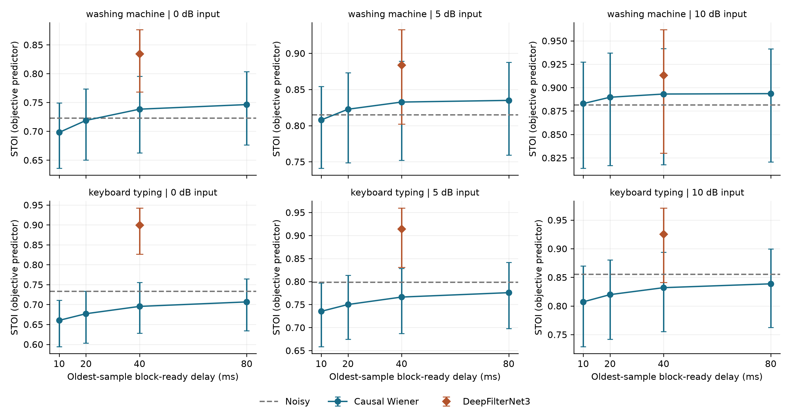
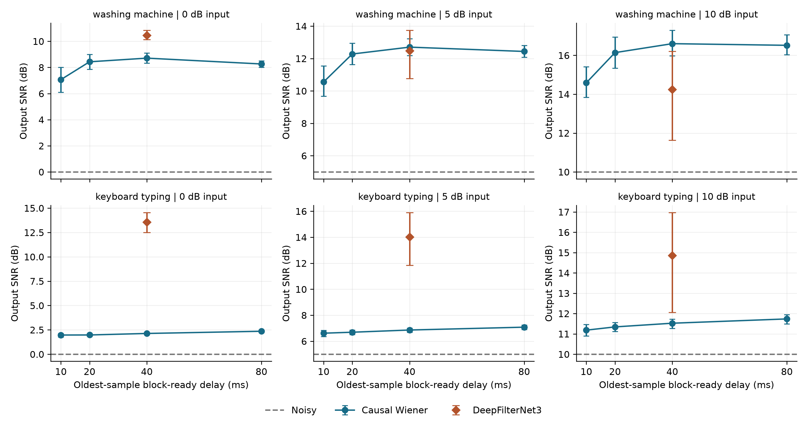
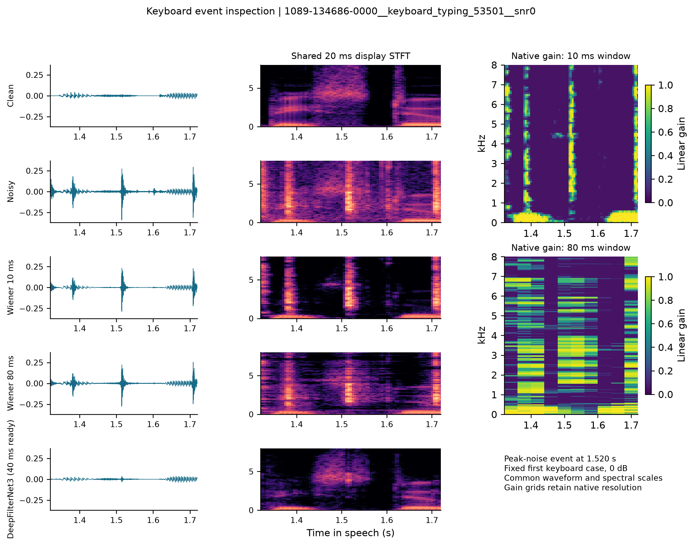
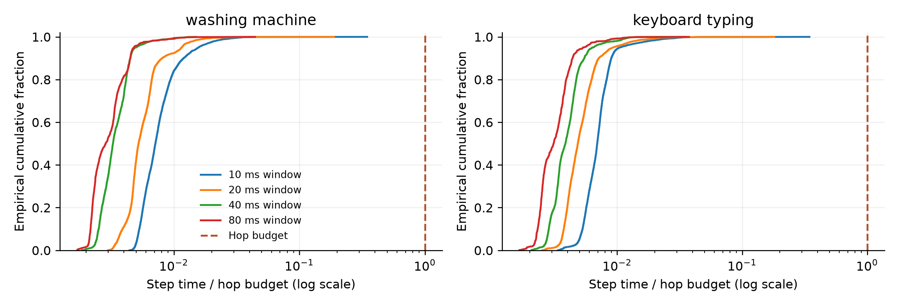

Latency-Quality Trade-offs in Real-Time Causal Speech Enhancement

ELEC5305 Final Project | Yixiang Ma | SID 550762913 | 2 November 2026

### Abstract

How much speech quality does a causal enhancer gain by waiting for more audio? We test four STFT Wiener windows (10/20/40/80 ms) with a shared 100 ms decision-directed smoothing time constant and compare them with the official pretrained DeepFilterNet3 reference. The primary LibriSpeech test-clean evaluation contains 144 paired mixtures from twelve utterances, six speakers, four noise recordings and three input SNRs. A native-48-kHz VCTK-derived cohort provides a secondary engineering comparison. On LibriSpeech at 0 dB keyboard SNR, Wiener40 raises waveform SNR to 2.13 dB but lowers STOI from 0.7336 to 0.6953. At the same 40 ms oldest-sample block-ready delay, DeepFilterNet3 reaches 13.55 dB SNR and 0.8998 STOI. Longer Wiener windows improve mean STOI in this condition, although waveform SNR peaks earlier. All 25,718 profiled external Wiener calls fit within their hop budgets on the tested CPU.

## 1. Introduction and research question

A causal speech enhancer must choose what to suppress using only the audio that has arrived. Longer analysis windows can reveal spectral structure, but they also delay output and combine events over a longer interval. Average processing speed tells us little about a missed block deadline. We therefore measure quality, output readiness and computation separately.

Research question: How does causal STFT scheduling delay affect Wiener enhancement quality, and how does this classical baseline compare with a pretrained enhancer at a reconciled delay budget? We examine single-channel speech mixed with recorded noise, using objective metrics and the official pretrained reference.

### 1.1 Contribution and project continuity

The semester project began with an offline synthetic FIR/Wiener demonstration. It then added a stateful causal processor, recorded keyboard noise and a pretrained reference. This final study keeps those processors and tests them across more speakers, noise sources and SNRs. We vary the Wiener window, reconcile each processor's output schedule, compare paired quality scores and inspect a keyboard event.

The earlier single-utterance examples form the development stage. Code, protocol, source identifiers, checks, full result tables and an audition app accompany this report.


---

## 2. Literature review and research rationale

### 2.1 Statistical spectral enhancement

Ephraim and Malah [1] distinguish Wiener spectral estimation from MMSE short-time spectral-amplitude estimation. Their decision-directed estimate of a priori SNR combines the current observation with preceding enhanced power. We use that idea to compute a Wiener gain from the estimated noise PSD, retaining the noisy phase.

A noise-only startup interval supplies the PSD estimate, which remains fixed during subsequent speech frames. The same estimation rule applies to every window. Later keyboard bursts then expose how the processor behaves when noise statistics change after calibration.

### 2.2 Learned multi-frame enhancement

Schroter et al. [2] combine coarse ERB-band envelope gains with complex multi-frame filtering of lower-frequency speech. The Wiener baseline instead applies a real gain to each frequency bin and retains noisy phase. The reference therefore tests a learned temporal representation against a processor whose noise model comes from a short startup interval.

The paper describes a 48 kHz system with 20 ms windows, 10 ms hops and two frames of lookahead. We inspect the pinned runtime and configuration [3] to determine when output becomes available. The paper also reports DNS4 training with VCTK oversampling. We therefore use LibriSpeech for the primary analysis and treat the VCTK-derived cohort as a secondary engineering comparison.

### 2.3 Complementary metrics and the gap addressed here

Taal et al. [4] provide an objective intelligibility predictor for time-frequency weighted speech. The standard pystoi implementation [5] correlates short-time one-third-octave envelopes after its prescribed preprocessing. It captures changes in speech-envelope structure alongside waveform-error metrics.

Le Roux et al. [6] motivate explicit separation-metric definitions and propose SI-SDR. We report zero-mean projection SI-SDR alongside ordinary reference-to-error SNR. SI-SDR tolerates an overall scale change; SNR penalises it. We preserve output amplitude for both measures and use STOI and fixed-gain audition to examine other aspects of quality.

| Literature / resource | Design consequence | Interpretation |
| --- | --- | --- |
| Statistical estimation [1] | Frozen decision-directed baseline | Wiener gain with noisy phase |
| Learned multi-frame method [2,3] | Pinned modern reference; reconcile lookahead | Pinned weights and runtime |
| STOI and SI-SDR [4-6] | Complementary paired metrics | Objective predictor and waveform measures |

Table 1. Prior work informs the processor, reference and complementary quality measures used in this latency-quality comparison.


---

## 3. Methods: stateful causal enhancement

Figure 1. Clean speech is used only for mixture construction and evaluation. Enhancement receives arrived mixture samples; the clean reference enters scoring after processing.

### 3.1 Causal framing and reconstruction

CausalWiener.step(arrived) carries pending input, past samples, overlap-add accumulators, calibration spectra and previous enhanced power across calls. For window length L and hop H=L/2, each frame combines the previous H samples with the newly arrived H samples. The processor applies a periodic Hann window, FFT, gain, inverse FFT and overlap-add with analysis-window weight normalisation. Past-only startup padding and an EOF zero flush handle the boundaries.

| Window / L (ms) | L (samples) | H (samples) | FFT length | Calibration frames |
| --- | --- | --- | --- | --- |
| 10 | 480 | 240 | 512 | 59 |
| 20 | 960 | 480 | 1024 | 29 |
| 40 | 1920 | 960 | 2048 | 14 |
| 80 | 3840 | 1920 | 4096 | 6 |

Table 2. All methods run at 48 kHz. The number of complete calibration frames in the shared 300 ms prefix varies with L.

### 3.2 Frozen Wiener rule

The processor averages complete noise-only frames as they arrive and then fixes the noise PSD D[k]. Let P[t,k]=|Y[t,k]|^2, Q[t-1,k] be the preceding enhanced power, and gamma=P/D. The decision-directed update and real gain are:

```text
alpha = exp(-H / (fs * 0.100))
xi = alpha * Q_previous / D + (1-alpha) * max(gamma-1, 0)
G = max(0.05, xi / (1+xi));  Q = G^2 * P
```

A PSD floor protects division. The 100 ms time constant keeps the physical smoothing time constant across all four hop settings. Changing the window and hop also changes observation support, frequency resolution, calibration averaging and output cadence. FFT zero-padding increases spectral sampling density.

### 3.3 Pretrained reference

We run the official v0.5.6 Windows Rust/Tract executable with a pinned DeepFilterNet3 ONNX archive [3], checking binary and model SHA256 hashes before execution. The reference uses published pretrained weights and default inference thresholds. Both processors receive the same float32 mixture. Wiener produces double-precision output; the reference CLI writes PCM16. These are the implementations used for the quality and timing measurements.


---

## 4. Experimental design and data provenance

### 4.1 Separate development, external and engineering cohorts

We fixed the final settings using the earlier p232_003 VoiceBank utterance, DEMAND washing-machine recording and ESC-50 keyboard source 137. For the primary external cohort, we take the first six lexicographically sorted LibriSpeech test-clean speaker IDs [7] and the first two sorted recordings per speaker lasting at least 4.5 s. We retain the first 4.5 s and resample once from 16 to 48 kHz using 3:1 polyphase conversion. The 16 kHz originals contain speech bandwidth up to 8 kHz. Resampling occurs before enhancement timing begins.

The secondary cohort uses twelve native-48-kHz utterances from the first six sorted speakers in the official VoiceBank clean training archive [8]. Because [2] reports VCTK in the reference model's training, this cohort supports an engineering comparison. We fixed the LibriSpeech selection rule and processor settings before external inference and report the two corpora separately.

| Cohort | Speakers | Speech recordings | Role |
| --- | --- | --- | --- |
| External: LibriSpeech test-clean | 1089, 1188, 121, 1221, 1284, 1320 | 2 per speaker; 12 total | Primary; 16 kHz source |
| Engineering: VoiceBank / VCTK | p226, p227, p228, p230, p231, p233 | 2 per speaker; 12 total | Secondary engineering comparison |

Table 3. Selection follows the stated deterministic source order. Manifests retain every recording ID, source URL and hash.

### 4.2 Noise selection and controlled mixtures

Each cohort uses two ESC-50 washing-machine sources (21896, 23996) and two keyboard sources (53501, 61212) [9]. Sorted filenames and distinct original source IDs determine the selection; development source 137 is excluded. We resample the first 4.9 s of each 5 s clip once from 44.1 to 48 kHz and use a continuous segment for each mixture.

```text
mixture = clean + beta * noise
beta = sqrt(sum(clean^2) / (10^(inputSNR/10) * sum(noise^2)))
```

We set the noise scale using the scored speech interval. Each input begins with 300 ms of recorded noise and ends with a 100 ms noise tail. A common attenuation per cohort leaves 0.8 peak headroom before float32 storage (external 0.22420135; engineering 0.28328995). We apply it to clean references as well and score the output at its original amplitude. Each cohort has 12 utterances x 4 recordings x 3 SNRs (0/5/10 dB) = 144 paired mixtures. Six scored conditions produce 864 rows.

### 4.3 Metrics and uncertainty

SNR is 10 log10(sum(clean^2)/sum((output-clean)^2)). SI-SDR removes means and projects output onto clean before taking the target-to-residual energy ratio. We use standard pystoi 0.4.1 with extended=False. After aligning each output by its measured processor shift, we score 4.5 s of speech and omit the prefix and tail. Within each noise/SNR group, we average the utterance/source outcomes for each speaker. We then draw 2,000 seed-5305 bootstrap resamples of the six speakers for exploratory 95% percentile intervals. Paired differences are calculated per speaker before resampling. These intervals reflect the six selected speakers and four fixed noise files.


---

## 5. Delay contract and validation

### 5.1 Reconcile waveform shift with output availability

We measure two different delays. Transport shift is the displacement between equal-length input and output block arrays. Output readiness is the time when a block can actually be emitted. For Wiener, a block starting at sample s is ready after samples through s+L have arrived. Its oldest sample has waited L/fs; its newest sample has waited (L-H+1)/fs. Playback starting at that ready timestamp has an L/fs sample delay, with computation and devices measured separately.

| System | Transport shift (ms) | Oldest-sample ready (ms) | Evidence |
| --- | --- | --- | --- |
| Wiener 10/20/40/80 | 5 / 10 / 20 / 40 | 10 / 20 / 40 / 80 | Impulse and per-block schedule |
| DeepFilterNet3 | 30 | 40 | Source/configuration + transport probe |

Table 4. The reference uses L=20 ms, H=10 ms and two lookahead frames, including the delay of both implemented lookahead paths.

For the reference, transport is L-H+2H=30 ms (1440 samples), and oldest-sample readiness is L+2H=40 ms. We therefore compare Wiener40 with DeepFilterNet3 at a shared 40 ms ready delay. The source shows persistent inference state and hop-based processing [3]; a near-identity probe measures the transport shift. Wiener uses a 300 ms noise-only prefix for calibration before steady-state processing. The reference receives the same prefix and follows its pretrained inference rule.

### 5.2 Validation before interpretation

| Check | Measured result | Scope |
| --- | --- | --- |
| Unit-gain reconstruction | Maximum external relative error 2.984e-16 | All 144 mixtures x 4 windows |
| Chunk and future invariance | Maximum differences 0 | All four Wiener settings on development checks |
| Reference delay / trimming | 1440 samples; exact CLI trim agreement | Separate development probes |
| Reference future / repeats | Future-prefix error 0; repeats bit-identical | Development probe + representative repeats |
| Shared input / input SNR | WAV=MAT exactly; max SNR error 1.38e-8 dB | All external mixtures |
| PCM16 full-scale flags | 0 / 144 external outputs | PCM16 sample threshold check |

Table 5. Development causality probes were rerun on this PC; reconstruction and input checks cover the final mixtures.

Rerunning the development quality table gives a maximum absolute difference of 3.82e-14, consistent with the earlier processor and scoring results. Capturing diagnostic gains changes the selected final outputs by less than 1e-12. EOF flushing starts after the last recorded sample arrives.

### 5.3 Compute measurement

We time each processor in sequential benchmark jobs, separate from quality scoring. After one unreported warm-up, seven repeats use the first utterance and first noise source of each class at 0 dB. Wiener RTF covers the sequential driver and EOF flush; construction, preallocation, I/O and metrics lie outside that timer. A full-hop step profile also records calibration and validation/timer overhead, with EOF flush outside recurring deadlines. The reference reports aggregate frame-loop time from its internal timer after setup. Each RTF therefore measures the stated implementation and timed operations.


---

## 6. Results: external intelligibility-predictor trade-off

Figure 2. External speaker-mean STOI versus oldest-sample block-ready delay. Bars are 95% speaker-bootstrap intervals, conditional on the four fixed noises. Dashed lines are noisy-input means; the neural point is at 40 ms.



| 0 dB input noise | Method | SNR (dB) | SI-SDR (dB) | STOI |
| --- | --- | --- | --- | --- |
| washing machine | Noisy | 0.00 | 0.00 | 0.7228 |
| washing machine | Wiener40 | 8.71 | 7.99 | 0.7384 |
| washing machine | DFNet3 | 10.46 | 10.32 | 0.8345 |
| keyboard typing | Noisy | 0.00 | 0.00 | 0.7336 |
| keyboard typing | Wiener40 | 2.13 | 1.45 | 0.6953 |
| keyboard typing | DFNet3 | 13.55 | 13.52 | 0.8998 |

Table 6. Matched 40 ms ready-delay systems at 0 dB. Each row averages 24 mixtures from six speakers; full window/SNR tables are supplied as CSV.

At 0 dB washing noise, Wiener STOI rises from 0.6981 at 10 ms to 0.7463 at 80 ms, crossing the noisy mean of 0.7228. Under keyboard noise it rises from 0.6602 to 0.7065 but stays below the noisy mean of 0.7336. At 0 dB, Wiener10/20/40 lower STOI in all 24 keyboard mixtures, and Wiener80 lowers it in 23. DeepFilterNet3 lowers it in none of the 24.

Within these windows, extra waiting helps the Wiener envelope-correlation score, but keyboard-noise STOI remains below the noisy input. At 40 ms, DeepFilterNet3 obtains 0.8998 keyboard STOI versus 0.6953 for Wiener40. Even Wiener80 reaches only 0.7065 with twice that ready delay.


---

## 7. Results: error metrics and paired comparisons

Figure 3. External output SNR on the same mixtures, alignment and speaker units as Figure 2. STOI and waveform SNR select different windows and methods in several conditions.



| Noise | Input SNR | DFNet3 - Wiener40 STOI [95% CI] |
| --- | --- | --- |
| washing machine | 0 | +0.0962 [+0.0720, +0.1156] |
| washing machine | 5 | +0.0512 [+0.0372, +0.0667] |
| washing machine | 10 | +0.0201 [+0.0099, +0.0313] |
| keyboard typing | 0 | +0.2045 [+0.1764, +0.2283] |
| keyboard typing | 5 | +0.1479 [+0.1173, +0.1790] |
| keyboard typing | 10 | +0.0937 [+0.0670, +0.1232] |

Table 7. Paired speaker-mean differences at the common 40 ms ready delay. Intervals resample the six speakers conditional on the selected noise recordings.

At 0 dB washing noise, output SNR climbs from 7.07 dB for Wiener10 to 8.71 dB for Wiener40, then drops to 8.26 dB for Wiener80. STOI continues to rise. The paired 80-minus-40 ms changes are -0.447 dB SNR [ -0.595, -0.303 ] and +0.00795 STOI [ +0.00410, +0.01161 ]. The two metrics therefore favour different windows in this condition.

At 10 dB washing input, Wiener40 reaches 16.60 dB SNR versus 14.25 dB for DeepFilterNet3. The reference-minus-Wiener difference is -2.355 dB [ -4.729, -0.628 ], while its STOI difference is +0.02008. SI-SDR also favours Wiener40 here (16.50 versus 14.50 dB). At 5 dB washing input, the SNR-difference interval includes zero. Keyboard noise reverses the SNR ordering: at 0 dB input, DeepFilterNet3 reaches 13.55 dB versus 2.13 dB for Wiener40. Across the selected keyboard recordings, the reference has higher mean SNR and STOI.


---

## 8. Keyboard event and secondary cohort

Figure 4. First external keyboard case, 0 dB. The event centre (1.520 s) maximises 20 ms true-noise energy on a 10 ms grid, excluding 300 ms speech boundaries.



| Illustrative 400 ms event | Noisy | Wiener10 | Wiener80 | DFNet3 |
| --- | --- | --- | --- | --- |
| Reference-to-error SNR (dB) | -6.66 | -4.99 | -4.81 | 11.31 |

The display STFT uses a 20 ms Hann window, 5 ms hop and FFT1024, giving all output spectrograms one grid. Gain maps retain their native frame resolutions and show the Wiener attenuation applied during processing. A PSD fixed from the prefix and a long decision-directed memory can miss later keyboard bursts; stronger attenuation can also weaken speech. This event motivates testing an adaptive noise estimator while keeping the other processor settings fixed.

### 8.1 Secondary native-48-kHz engineering comparison

On the VCTK-derived cohort at 0 dB, washing STOI is 0.7169 noisy, 0.7254 Wiener40 and 0.8362 for the reference. Keyboard values are 0.7004, 0.6582 and 0.8805. The keyboard case again shows that waveform SNR can improve while STOI worsens. We report this cohort separately because it draws on VCTK-related speech used in reference training [2] and differs from LibriSpeech in bandwidth and level.


---

## 9. Runtime and evaluation conditions

Figure 5. External Wiener empirical distributions of step time divided by hop budget. Values below one fit the recurring input interval in these measured calls. Step timings include instrumentation overhead.



| Noise | Window (ms) | RTF median | Step p99 (ms) | Step max (ms) | Hop (ms) |
| --- | --- | --- | --- | --- | --- |
| washing machine | 10 | 0.0080 | 0.131 | 1.734 | 5 |
| washing machine | 20 | 0.0057 | 0.167 | 1.889 | 10 |
| washing machine | 40 | 0.0035 | 0.183 | 0.301 | 20 |
| washing machine | 80 | 0.0034 | 0.368 | 1.777 | 40 |
| keyboard typing | 10 | 0.0075 | 0.117 | 1.728 | 5 |
| keyboard typing | 20 | 0.0053 | 0.184 | 1.808 | 10 |
| keyboard typing | 40 | 0.0041 | 0.225 | 0.694 | 20 |
| keyboard typing | 80 | 0.0030 | 0.364 | 1.501 | 40 |

Table 8. Seven repetitions per representative noise/window condition. Windows with longer hops can reduce per-second call overhead even when a single step takes longer.

All 25,718 profiled external full-hop Wiener calls fit their hop budgets. DeepFilterNet3 median RTF is 0.0666 for washing and 0.0628 for keyboard. The computer has an Intel Core i7-14700HX (20 cores, 28 logical processors), approximately 31.8 GiB RAM and Windows 11 build 26200. Processing uses MATLAB R2026a Update 5 and Python 3.12.14; scoring uses numpy 2.4.6, scipy 1.17.1 and pystoi 0.4.1. The timings measure these implementations on this computer and input duration.

### 9.1 Evaluation conditions

Each cohort samples six speakers and two recordings per noise class. The speaker bootstrap varies speakers while holding those noise recordings fixed. Controlled mixing provides clean references for scoring, and Wiener begins with 300 ms of noise-only calibration. The next evaluation stage would include room acoustics, microphone capture and calibration contaminated by speech.

The reference writes PCM16 output and Wiener retains double precision; they also use different compute backends. The reference sees 945 external 10 ms input blocks below its 1e-7 silence-power threshold, compared with 542 in the secondary cohort. We measure Wiener per-hop time and reference aggregate RTF. Device-loop timing and listener responses form the next measurements.


---

## 10. Discussion and conclusion

Across the tested 10-80 ms Wiener windows, mean STOI generally improves with longer ready delay. Waveform SNR can peak at a shorter window, and keyboard-noise STOI stays below the noisy input. At the shared 40 ms ready delay, DeepFilterNet3 has higher mean STOI in every external noise/SNR condition, with positive paired intervals. Wiener40 retains higher SNR and SI-SDR in the 10 dB washing condition. The preferred processor and window depend on whether the task prioritises envelope correlation, waveform error or output delay.

The pattern fits the methods in [1-3]: the Wiener estimator uses a fixed noise PSD and a real gain, whereas DeepFilterNet3 uses learned multi-frame complex filtering. We connect this difference to measured output schedules and paired quality results across two recorded noise classes. The public manifests, mixture recipe and scoring code specify the population behind each comparison.

### Reproducible deliverables

The repository contains the runnable processors and preparation/scoring scripts, manifests, exact CSV results, validation evidence and instructions. launch_final_demo reruns selected methods, verifies agreement with evaluated outputs and plays clean/noisy/processed recordings at one common gain. The accompanying short video shows actual app results and those audio excerpts. Repository: https://github.com/Simon1ma/elec5305-project-550762913 .

### References

[1] Y. Ephraim and D. Malah, "Speech Enhancement Using a Minimum Mean-Square Error Short-Time Spectral Amplitude Estimator," IEEE Trans. ASSP, 32(6), 1109-1121, 1984. https://malah.net.technion.ac.il/files/2017/08/Ephraim_Speech_Enhancement_ASSP84.pdf

[2] H. Schroter et al., "DeepFilterNet: Perceptually Motivated Real-Time Speech Enhancement," arXiv:2305.08227, 2023. https://arxiv.org/abs/2305.08227

[3] Rikorose/DeepFilterNet, official v0.5.6 runtime and DeepFilterNet3 model; source commit 978576aa8400552a4ce9730838c635aa30db5e61. https://github.com/Rikorose/DeepFilterNet/tree/978576aa8400552a4ce9730838c635aa30db5e61

[4] C. H. Taal et al., "An Algorithm for Intelligibility Prediction of Time-Frequency Weighted Noisy Speech," IEEE Trans. ASLP, 19(7), 2125-2136, 2011. https://doi.org/10.1109/TASL.2011.2114881

[5] M. Pariente et al., pystoi, standard STOI implementation, version 0.4.1 used. https://github.com/mpariente/pystoi

[6] J. Le Roux, S. Wisdom, H. Erdogan and J. R. Hershey, "SDR - half-baked or well done?" ICASSP 2019; arXiv:1811.02508. https://arxiv.org/abs/1811.02508

[7] V. Panayotov, G. Chen, D. Povey and S. Khudanpur, "LibriSpeech: an ASR corpus based on public domain audio books," ICASSP 2015. Test-clean, OpenSLR SLR12, CC BY 4.0. https://www.openslr.org/12/

[8] C. Valentini-Botinhao, "Noisy speech database for training speech enhancement algorithms and TTS models," University of Edinburgh, 2017; clean training recordings, CC BY 4.0. https://doi.org/10.7488/ds/2117

[9] K. J. Piczak, "ESC: Dataset for Environmental Sound Classification," ACM Multimedia 2015. ESC-50 commit 33c8ce9eb2cf0b1c2f8bcf322eb349b6be34dbb6; CC BY-NC with individual clip attributions. https://github.com/karolpiczak/ESC-50
