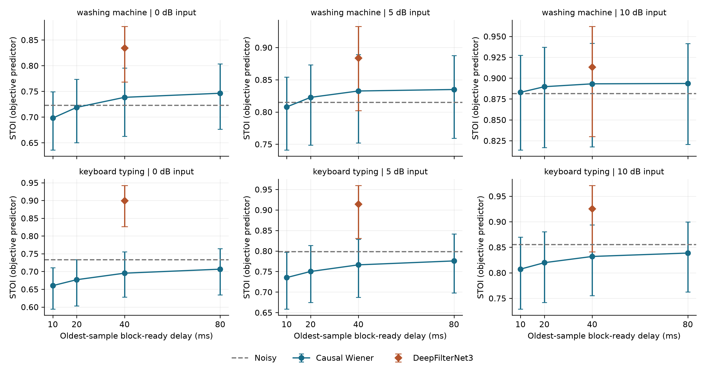
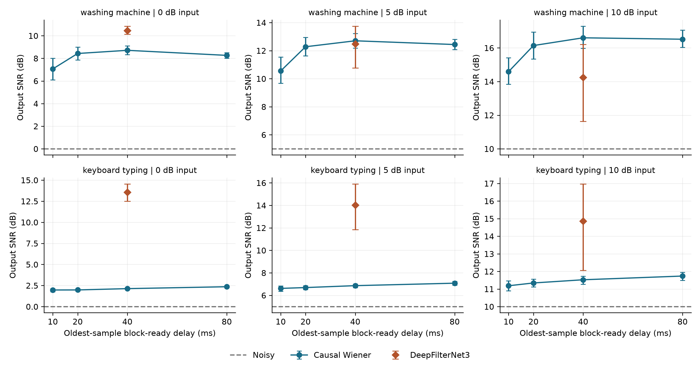
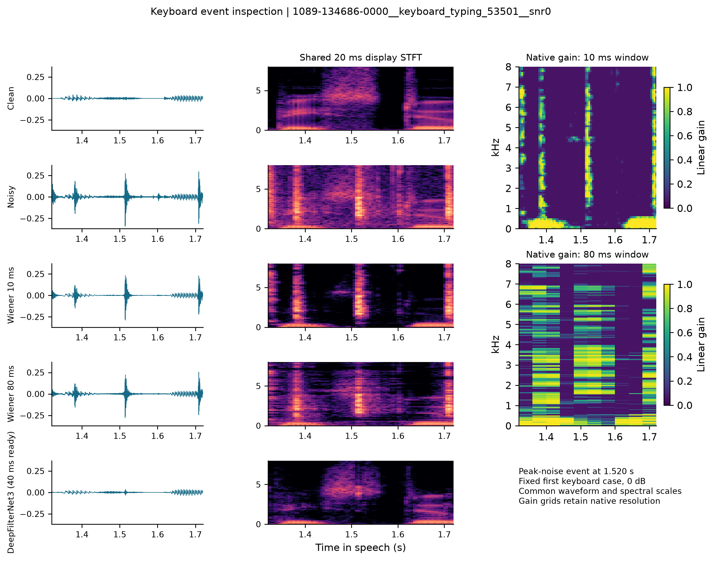

# Final primary external evaluation: LibriSpeech test-clean

**Research question:** How does causal STFT scheduling delay affect Wiener
speech-enhancement quality, and how does the classical baseline compare with
official pretrained DeepFilterNet3 at a reconciled ready delay?

This cohort uses 12 utterances from six official test-clean speakers (1089,
1188, 121, 1221, 1284, 1320), two ESC-50 washing-machine recordings and two
keyboard recordings at 0/5/10 dB. Selection is deterministic and fixed before
external processing. There are 144 paired mixtures and 864 quality rows. Source
IDs, SHA256, input hashes, exact mixture SNRs and the global input attenuation
are in [input_manifest.json](input_manifest.json). Speech is 16 kHz source
resampled to 48 kHz; this adds no content above 8 kHz. Complete upstream model
training overlap cannot be excluded. See the
[protocol amendment](../../docs/pretraining_overlap_audit.md).

| Noise, 0 dB input | Noisy STOI | Wiener40 STOI / output SNR | DFNet3 STOI / output SNR |
| --- | ---: | ---: | ---: |
| Washing machine | 0.7228 | 0.7384 / 8.71 dB | 0.8345 / 10.46 dB |
| Keyboard typing | 0.7336 | 0.6953 / 2.13 dB | 0.8998 / 13.55 dB |

Wiener40 and DeepFilterNet3 both have a 40 ms *oldest-sample block-ready*
delay under the common convention. The neural reference has a 30 ms transport
shift; Wiener40 has 20 ms. These shifts are removed for quality scoring without
a quality-optimising delay search. The 300 ms noise-only Wiener calibration is
a separate startup requirement. Processing, resampling, OS and device delays are
outside the quoted ready delays.

At 0 dB keyboard input, Wiener10/20/40 reduce STOI below noisy speech in all
24 paired cases; Wiener80 does so in 23, despite improved waveform SNR.
DeepFilterNet3 reduces STOI in none of these 24 cases. For 10 dB washing noise,
Wiener40 has higher mean waveform SNR than the reference (16.60 versus 14.25 dB),
while the reference has higher STOI (0.9132 versus 0.8931). Thus no single method
is best on all measured objectives.

## Reproducibility files

- [Full quality table](metrics.csv), [speaker means and 95% bootstrap intervals](summary_by_condition.csv),
  [paired contrasts against Wiener40](paired_vs_wiener40.csv), and
  [STOI decrease counts](stoi_decrease_counts.csv). Intervals resample the six
  speakers, conditional on these four noise recordings, with 2,000 replicates
  and seed 5305. They are exploratory rather than broad population estimates.
- [Wiener construction/ready/reconstruction checks](wiener_checks.csv),
  [reference alignment/clipping checks](reference_checks.csv),
  [input/metric verification](quality_verification.json), and
  [validation summary](validation_summary.json). Maximum unit-gain reconstruction
  relative error is 2.984e-16, WAV/MAT shared inputs match exactly, and no
  reference PCM16 full-scale flag appears in 144 outputs.
- [Wiener RTF](wiener_benchmark.csv), [reference RTF](reference_benchmark.csv),
  and [per-hop summary](block_timing_summary.csv); raw Wiener step timings are
  in [wiener_block_timings.csv](wiener_block_timings.csv). Seven repeats follow
  one omitted warm-up, on the first utterance and first recording of each noise
  class at 0 dB. Jobs ran sequentially on an i7-14700HX, Windows 11, MATLAB
  R2026a Update 5. No profiled Wiener full-hop step exceeded its hop budget
  in 25,718 measured calls. Reference per-hop times are unavailable from the
  official CLI. The two RTF scopes/backends differ, so this is not a direct
  algorithmic-complexity ranking or a hard real-time guarantee.
- [Event selection](event_selection.json) and [event SNRs](event_metrics.csv):
  the fixed first keyboard case and the peak 20 ms true-noise-energy event were
  chosen independently of enhancement outcomes. The figure uses shared display
  grids and actual native gain maps. It is one illustrative event, not another
  independent sample or a short-event intelligibility score.
- [Video manifest](video_manifest.json) records the fixed listening case, common
  playback gain, actual MATLAB app exports and video SHA256. Derived audio
  excerpts are in [audio/](audio/). [Source attributions](../../docs/final_data_attribution.md).

The pretrained model is pinned by source, executable hash and model hash.
Original recordings, large archives, weights and the executable are retrieved
locally by [the final run instructions](../../code/final/README.md).
