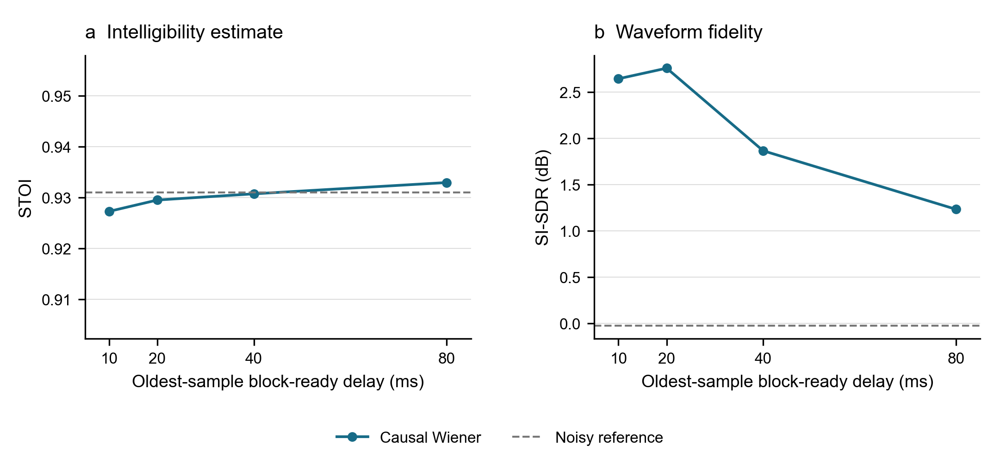

# Causal Latency Experiment: First Recorded-Speech Milestone

Date: 28 October 2026. This is engineering progress for the final project, not a completed final evaluation.

## Research Revision

The revised question is **how enhancement quality changes under explicit causal latency constraints**. Wiener filtering is an established classical baseline, not the research novelty. A pretrained low-latency reference will be added after validating the streaming experiment.

## Experiment

One VoiceBank+DEMAND clean utterance, `p232_003.wav`, is mixed with DEMAND `DWASHING/ch01.wav` at exactly 0 dB input SNR. Both are native 48 kHz; the speech lasts approximately 7.185 seconds. The noise segment starts at 10 seconds. A separate 300 ms noise-only calibration precedes speech. This is recorded washing-machine noise, not a fan or a keyboard recording.

The same stateful Wiener processor is tested with 10, 20, 40, and 80 ms periodic Hann windows, 50 percent overlap, FFT lengths 512/1024/2048/4096, a fixed initial PSD estimator, a 100 ms decision-directed smoothing time constant, and minimum gain 0.05. No parameters were selected to maximise the reported scores. The exact file/segment selection rule, source URLs, and hashes are in [the data manifest](data_manifest.json).

## Measured Quality and Compute Results

| Window (ms) | Oldest-sample ready delay (ms) | Output SNR (dB) | SI-SDR (dB) | STOI | Median RTF |
| --- | --- | --- | --- | --- | --- |
| 10 | 10 | 3.12 | 2.65 | 0.9273 | 0.0291 |
| 20 | 20 | 2.83 | 2.76 | 0.9295 | 0.0192 |
| 40 | 40 | 1.92 | 1.87 | 0.9307 | 0.0146 |
| 80 | 80 | 1.28 | 1.23 | 0.9330 | 0.0118 |

The unprocessed mixture has SNR 0.00 dB, SI-SDR -0.0244 dB, and STOI 0.9310. Because input SNR is 0 dB, output SNR and SNR improvement have the same numerical values in this example.

The 10 ms configuration provides the largest SNR improvement. SI-SDR is slightly higher at 20 ms, while STOI is slightly higher at 80 ms. Three enhanced STOI values are slightly below the unprocessed value. Therefore waveform SNR improvements do not establish improved intelligibility, and a longer window is not uniformly better. The small STOI differences are observations on one utterance, not statistically established effects.

**Figure 1.** STOI (a) and SI-SDR (b) for the same utterance/mixture under four window configurations. Dashed lines indicate unprocessed quality. Lines connect observed configurations only. No speech-population error bars are shown because n=1 utterance; repeated timing runs do not supply independent speech examples.

## What the Delay Numbers Mean

The processor consumes sequential H-sample input blocks. For each output block starting at logical sample s, the schedule trace confirms that input through sample s+L must have arrived. Thus the oldest-sample block-ready delay is L/fs. The newest sample in the same output block has age `(L-H+1)/fs`.

The unit-gain impulse test separately measures an H-sample transport shift in equal-length input/output block arrays: 5/10/20/40 ms. That shift plus an H-sample capture packet gives the conservative L/fs playback interpretation used in Figure 1. Some STFT systems quote only L-H; those conventions must be reconciled before comparing models.

These figures exclude computation, device, operating-system, and network delay. The 300 ms initial calibration is a separate startup requirement. This is a causal recorded-file simulation, not a sound-card or end-to-end call latency measurement.

## Verification

- Unit-gain relative reconstruction error below 3e-16 for all four settings in both random-signal and recorded-mixture checks.
- Irregular input chunking produces identical outputs.
- Altering future input produces zero difference in already-emitted outputs.
- Impulse transport shifts and per-block readiness schedules match their explicit definitions.
- Metrics remove only the known transport shift and noise-only prefix; no lag optimisation or independent output normalisation.
- STOI identity and SI-SDR scale-invariance checks passed.

RTF was measured in MATLAB R2026a Update 5 on the same CPU, seven repeats following one warm-up per configuration. Timing includes construction, calibration processing, sequential blocks, and final flush; excludes file I/O, plots, and quality metrics. The denominator includes calibration audio. All median RTF values are below 0.03, but this does not prove every block meets a real-time deadline.

## Files and Reproduction

- [MATLAB/Python run instructions](../../code/latency/README.md)
- [Exact quality metrics](metrics.csv)
- [Raw timing summary](benchmark.csv)
- [Causality and reconstruction checks](checks.csv)
- [Input provenance](data_manifest.json)
- [MATLAB environment](environment.txt)
- [Metric environment](metric_environment.json)

Unscaled signals and generated WAVs are local reproducible outputs, not committed source datasets. Run the preparation, MATLAB experiment, and Python scoring commands to regenerate them.

## Limits and Next Milestones

This single speaker/utterance is a development example, not an untouched evaluation set. The nominal noise-only duration is fixed, but the number of complete calibration frames differs (59/29/14/6). This affects PSD estimation uncertainty and limits attributing changes only to frequency resolution. Fixed PSD also limits performance when noise changes. Paired comparisons on more speaker/source-disjoint recordings are needed.

Actual keyboard/transient-noise experiments, event-level Wiener-gain inspection, broader evaluation, and pretrained DeepFilterNet streaming/latency comparison are **not yet completed**. Neither the old offline FIR result nor a whole-file neural enhancement command will be presented as a causal real-time comparator.

## Sources

- C. Valentini-Botinhao, *Noisy speech database for training speech enhancement algorithms and TTS models*. [Dataset](https://doi.org/10.7488/ds/2117); CC BY 4.0 per its End-user Licence.
- J. Thiemann, N. Ito, and E. Vincent, *DEMAND*. [Dataset](https://zenodo.org/records/1227121); CC BY-SA 3.0 per its description.
- [pystoi](https://github.com/mpariente/pystoi), classical STOI implementation; `extended=False`.
- [DeepFilterNet](https://github.com/Rikorose/DeepFilterNet) and [DNS Challenge](https://github.com/microsoft/DNS-Challenge), resources for the next reference comparison.
